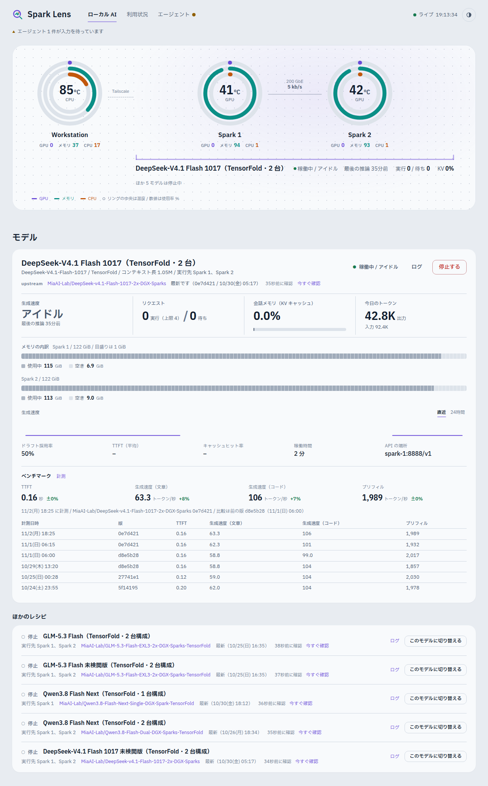
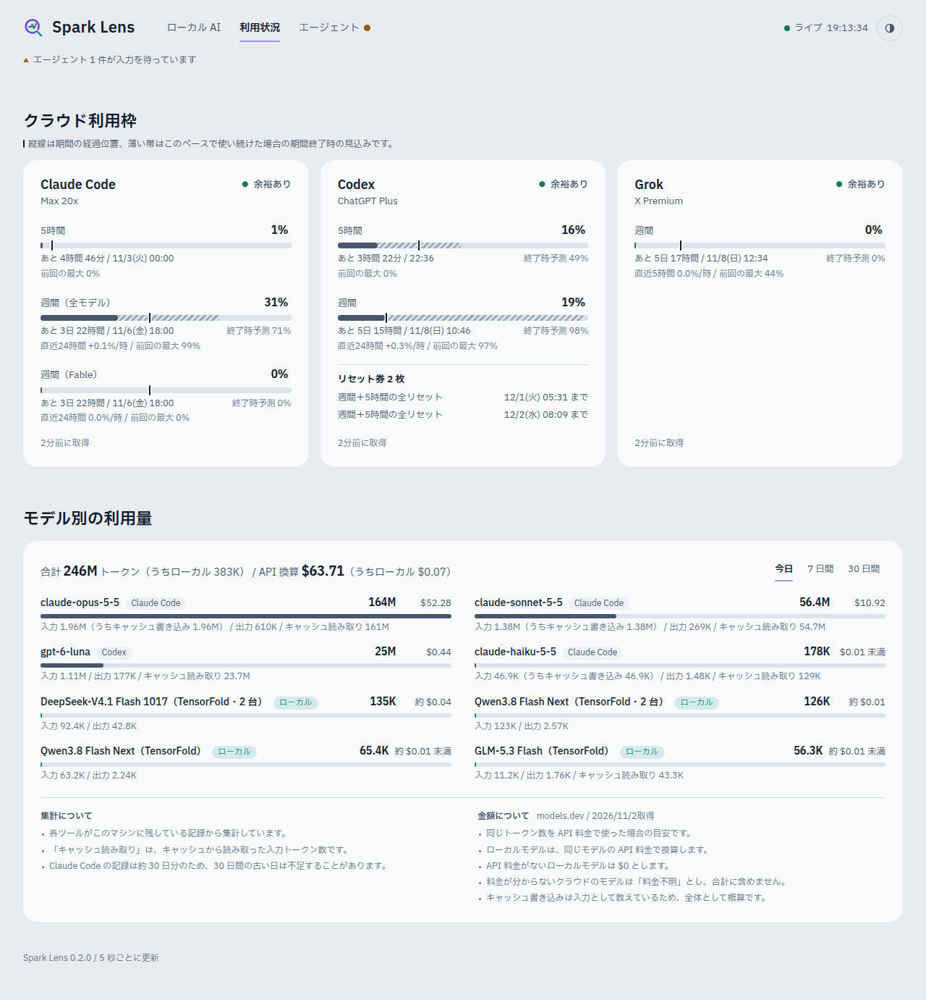
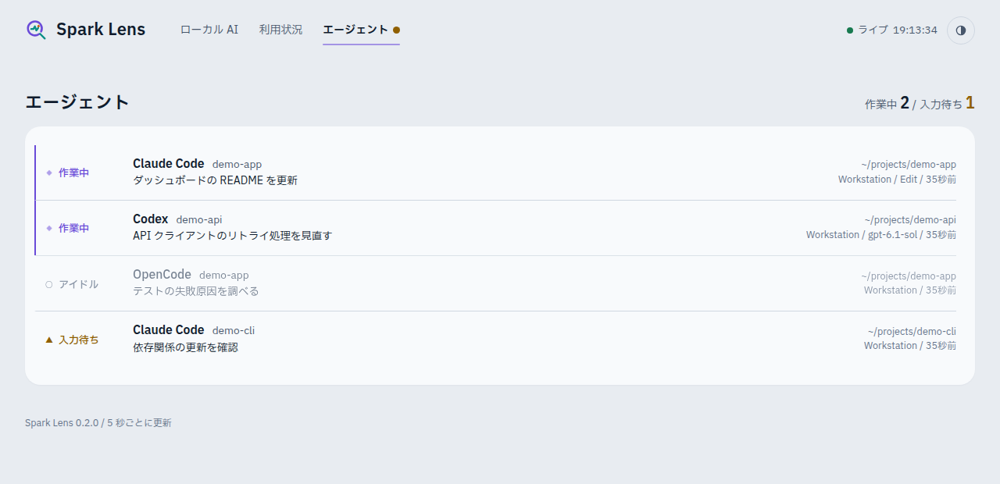

# Spark Lens

開発版のバージョンは `package.json` に記載しています。公開リリースの履歴は [CHANGELOG.md](CHANGELOG.md)、更新・タグ付けの手順は [docs/RELEASING.md](docs/RELEASING.md) を参照してください。

自宅・小規模のローカル AI 環境を、ブラウザ 1 画面で見渡すためのダッシュボードです。

- 開発機と DGX Spark の GPU・メモリ・CPU・温度・ストレージ・ネットワーク・コンテナ
- ローカル LLM（vLLM・SGLang・TensorFold・llama.cpp など）の稼働状態、生成速度、処理中の件数、先読み（投機的デコード）の効き具合、今日のトークン数
- クラウド利用枠（Claude Code・Codex・OpenCode Go・Grok）の使用率とリセット時刻
- いま動いている coding agent と、その作業内容、モデル別のトークン利用量

<picture>
  <source media="(prefers-color-scheme: dark)" srcset="docs/images/lab-dark.png">
  
</picture>

画面は 3 ページです。

- ローカル AI：ラボの構成図（開発機 → Spark 2 台と、その間の高速回線、2 台にまたがるモデル）を先頭に、モデルの状態と起動・停止、各マシンの詳細を並べます。回線は実際の通信量（RDMA を含む）に応じて流れ、モデルは推論中だけ光ります
- 利用状況：クラウド利用枠と、ローカル・クラウドを合わせたモデル別のトークン利用量、ローカル LLM の API 料金換算・節約相当額
- エージェント：いま動いている coding agent

各タブには、そのページで注意が必要なこと（黄・赤の点）や作業中の件数が出ます。ほかのページで問題があるときだけ、画面上部に「要確認」の帯が出ます。スマートフォンでは下部のタブで切り替えます。

| 利用状況 | エージェント |
| --- | --- |
|  |  |

画像はサンプルデータで表示したものです（実際の画面からマシン名や作業内容を置き換えています）。

ローカル AI のページからは登録した「レシピ」（モデルの起動スクリプト）の起動・停止とログの確認もできます。

監視される側のマシンには何もインストールしません。Spark Lens は開発機で動き、Spark へは数秒おきに SSH で短いスクリプトを流すだけなので、Spark の GPU とメモリは推論のために空いたままです。

## 必要なもの

- Node.js 24 以上と pnpm（開発機）
- 監視したいマシンへ、パスワードなしで入れる SSH（`ssh <ホスト名>` が通ること）
- 手元の PC やスマートフォンから見る場合は Tailscale

## 使い始める

```bash
git clone https://github.com/unitea1992/spark-lens.git
cd spark-lens
pnpm install

mkdir -p ~/.config/spark-lens
cp config/config.example.json ~/.config/spark-lens/config.json
# ~/.config/spark-lens/config.json のホスト名を自分の環境に合わせて書き換える

deploy/install.sh        # ビルドして systemd のユーザーサービスとして常駐させる
```

`http://127.0.0.1:8686` を開くと表示されます。設定を変えたら `systemctl --user restart spark-lens` で反映します。

設定ファイルがなければ、そのマシン自身と 3 つのクラウド利用枠だけを表示します。

### Tailscale 経由で見る

Spark Lens 自体は開発機の内側（127.0.0.1）だけで待ち受けます。Tailscale に中継させると、同じ tailnet の端末からだけ HTTPS で開けるようになります。

```bash
tailscale serve --bg --https=8686 http://127.0.0.1:8686
```

表示された `https://<マシン名>.<tailnet>.ts.net:8686/` を PC やスマートフォンで開いてください。やめるときは `tailscale serve --https=8686 off` です。

ログイン機能はありません。tailnet の外へ公開する（Tailscale Funnel やポート開放）使い方は想定していません。

## 設定

`~/.config/spark-lens/config.json`（場所は環境変数 `SPARK_LENS_CONFIG` で変更可）。全体の例は [`config/config.example.json`](config/config.example.json) にあります。

| 項目 | 既定値 | 内容 |
|---|---|---|
| `server.host` / `server.port` | `127.0.0.1` / `8686` | 待ち受けるアドレスとポート |
| `server.allowedHosts` | `[]` | 独自ドメインで開く場合に、そのホスト名を追加する |
| `pollSeconds` | `5` | マシンと LLM を確認する間隔 |
| `agentPollSeconds` | `15` | エージェントを確認する間隔 |
| `subscriptionPollSeconds` | `300` | クラウド利用枠を取得する間隔 |
| `hosts[]` | このマシンのみ | 監視するマシン |
| `llms[]` | なし | 監視するローカル LLM |
| `subscriptions[]` | 3 サービス | 表示するクラウド利用枠 |
| `agents.processes[]` | なし | 追加で検出したいエージェントのプロセス |

### マシン（`hosts`）

```json
{ "id": "spark-1", "label": "DGX Spark 1", "kind": "spark", "ssh": "spark-1" }
```

- `ssh`: SSH の接続先。`~/.ssh/config` の別名か `user@host`。このマシン自身を見るときは代わりに `"local": true`
- `kind`: `spark`（GPU を主役に表示）、`workstation`、`server`
- `mounts`: 容量を表示するマウントポイント。既定は `["/"]`

### ローカル LLM（`llms`）

```json
{
  "id": "glm-5-3-flash",
  "label": "GLM-5.3 Flash",
  "baseUrl": "http://spark-1:8888",
  "nodes": ["spark-1", "spark-2"],
  "containers": ["glm53-exl3-head", "glm53-exl3-worker"]
}
```

- `baseUrl`: OpenAI 互換サーバーのアドレス（`/v1` は付けない）。`/health`・`/v1/models`・`/metrics` を読みます
- `model`: サーバーが `/v1/models` で返すモデル名。複数のレシピが同じポートを使う場合に指定すると、実際に動いているモデルだけが「稼働中」になります
- `engine`: `vllm`・`sglang`・`tensorfold`・`llamacpp`・`lmstudio`・`ollama`。省略（`auto`）すると応答から自動で判別します。SGLang は起動時に `--enable-metrics` を付けないと速度などの数値が出ません
- `nodes`: そのモデルが載っているマシンの `id`
- `containers`: モデルを動かすコンテナ名。API がまだ応答しなくてもコンテナが起動していれば「起動中」と表示します。同じモデル名を返す別のレシピと見分けるのにも使います（API が応答していても、このコンテナが動いていなければ「停止中」）
- `apiKeyEnv`: API キーが必要なサーバーの場合、キーを入れた環境変数の名前（キー自体は設定ファイルに書きません）
- `apiPriceAs`: 任意。API換算に使う `models.dev` の `provider/model-id`（例：`"deepinfra/deepseek-ai/deepseek-v4.1-flash-1017"`）。明示すると `label` が変わっても比較元を維持できます
- `apiPriceComparison`: `"same_model"`（同じ公開モデル）か `"proxy"`（改変モデルなどの参考比較）。`apiPriceAs` のみ指定時は保守的に `proxy` と表示します

上の例は [GLM-5.3 Flash EXL3 on DGX Spark](https://github.com/MiaAI-Lab/GLM-5.3-Flash-EXL3-2x-DGX-Sparks) を 2 台構成で動かした場合の値です。

### レシピ（`recipes`）

モデルの起動・停止をダッシュボードのボタンから行うための登録です。upstream の起動スクリプトをそのまま呼び出すので、スクリプト側に手を加える必要はありません。

```json
{
  "id": "glm-5-3-flash",
  "label": "GLM-5.3 Flash",
  "host": "spark-1",
  "group": "sparks",
  "llm": "glm-5-3-flash",
  "dir": "~/tools/local-llm/glm-5.3-flash/upstream",
  "start": "./start.sh",
  "stop": "./start.sh stop",
  "logs": "docker logs --tail 300 glm53-exl3-head"
}
```

- `host` と `dir`: どのマシンのどのディレクトリでコマンドを実行するか
- `start` / `stop`: 起動・停止のコマンド。起動はそのマシン上で切り離して実行され、出力はそのマシンの `~/.local/state/spark-lens/recipe-<id>.log` に残ります。ダッシュボードを再起動しても起動処理は止まりません
- `logs`: 「サーバーログ」に表示する内容を出力するコマンド（省略可）
- `llm`: このレシピが動かすモデル（`llms` の `id`）。稼働中かどうかの判定に使います
- `group`: 同じマシンを使うレシピの組。同じ組で同時に動かせるのは 1 つだけで、ほかが動いている間は起動ボタンが押せません。省略すると `host` が組になります

各レシピのディレクトリが git の clone なら、3 時間ごと（と「今すぐ確認」ボタン）に upstream を `git fetch` して、取り込んでいない更新の件数と内容、手元で追跡ファイルを変更していないか、upstream の設定例に増えた項目が `.env` にないか、を表示します。「更新する」で停止 → `git pull --ff-only` → 起動し直し、を一度に行います（停止中なら取り込みだけ）。追跡ファイルに手元の変更がある場合は、独自の変更を上書きしないよう更新しません。

ボタン操作に認証はありません。tailnet の中から開ける人は誰でも起動・停止できる前提です。別のサイトから閲覧者のブラウザを使って操作させることはできないようにしてあります（操作には画面からだけ付く専用のヘッダーが必要です）。

### ベンチマーク

ローカル AI のページの「計測」ボタン、またはコマンド `pnpm bench <llm-id>` で、稼働中のモデルを同じ手順で測ります。測るのは、最初のトークンまでの時間（TTFT）、文章とコードの生成速度、プレフィルの速さです。結果は画面に直近 100 件まで残ります。すべての記録は `bench-data/spark-lens-bench/runs.jsonl` に 1 行ずつ追記されます（Git の追跡対象外。場所は `SPARK_LENS_BENCH_DIR` で変えられます）。

モデルを起動した直後は、表示が稼働中になるまで `pollSeconds` ほどかかります。その間に計測を始めると「モデルが稼働していません」と返るので、表示が稼働中になってから実行してください。

### マシンのクロック上限

CPU は `scaling_max_freq`、GPU は systemd のユニットに書かれた `nvidia-smi -lgc 最小,最大` を読み、上限を絞っている場合はその値を上限として表示します。

### クラウド利用枠（`subscriptions`）

| `type` | 取得元 | 前提 |
|---|---|---|
| `claude-code` | Anthropic の使用状況 API | 開発機で `claude` にサブスクリプションでログイン済み |
| `codex` | ChatGPT の使用状況 API | 開発機で `codex` に ChatGPT アカウントでログイン済み |
| `opencode-go` | OpenCode Go の使用状況 API | 開発機で `opencode auth login` 済み（または環境変数 `OPENCODE_GO_API_KEY`） |
| `grok` | Grok Build の使用状況 API | 開発機で `grok login` 済み（SuperGrok・X Premium など） |
| `command` | 任意のコマンドの出力 | 下記 |

認証情報は各ツールが保存しているものをその都度読むだけで、Spark Lens は複製も更新もしません。ログインの期限が切れたときは、そのツールを一度起動すれば元に戻ります。サブスクリプションを解約したときは、そのサービスを `subscriptions` から外します。カードが消え、`/api/quota` の振り分け候補からも外れます。

> [!IMPORTANT]
> **利用枠の取得について**
>
> `claude-code`・`codex`・`grok` は、各ツールが開発機に保存しているログイン情報（`~/.claude/.credentials.json`、`~/.codex/auth.json`、`~/.grok/auth.json`）を読み、Claude Code・Codex・Grok Build が自身の画面で使っている使用状況のエンドポイント（`api.anthropic.com/api/oauth/usage` と `/api/oauth/profile`、`chatgpt.com/backend-api/wham/usage`、`cli-chat-proxy.grok.com/v1/billing` と `/v1/settings`）を呼びます。いずれも公開・文書化された API ではありません。
>
> - 呼ぶのは使用状況の読み取りだけです。モデルの利用、リセット券の使用、ログイン情報の更新・複製・外部送信は行いません。
> - 取得は 5 分おきで、混雑やエラーの応答を受けたら 10〜60 分空けます。
> - Anthropic の規約と Claude Code の文書は、サブスクリプションのログイン情報を Anthropic 製以外のツールで使うことを制限しています。同様の取得は ccstatusline や CodexBar などでも広く行われていますが、各社が認めたものではありません。仕様変更で取れなくなる可能性もあります。
> - 使うかどうかはご自身で判断してください。使わない場合は `subscriptions` から外せば、ログイン情報は一切読みません。
>
> 規約に沿った代わりの情報源として、Claude Code はステータスラインのコマンドに `rate_limits`（5 時間・週間）を渡し、Codex は会話記録（`~/.codex/sessions`）に使用率を書き残します。モデル別の枠や claude.ai での利用分は含まれないため、Spark Lens は現状これらを使っていません。

バーの上の縦線は「期間がどこまで進んだか」を示します。バーが縦線より右にあれば、均等に使うペースより速く消費しています。その下には、ここまでの使い方が続いた場合に期間終了時に何 % になるか（上限に届きそうなら、あと何時間で届くか）を表示します。

プラン名は、Claude Code はアカウント情報の API（`api.anthropic.com/api/oauth/profile`）から取得するので、プランを変えると次の取得で表示も変わります。この API から取れないときは、ログイン情報（`subscriptionType` と `rateLimitTier`）に保存されたログイン時のプランを表示します。Codex は使用状況 API の `plan_type` から取得します。OpenCode Go は Go プラン専用の API なので常に「Go」です。Grok はプラン表示（`subscription_tier_display`）を読みます。Grok の利用枠はチャット・画像・音声・Build で共有される週間の枠です。Codex のリセット券は枚数と期限を表示します。Claude のリセット券は Claude Code のログインで読める API に含まれないため表示できません。

#### ほかのサービスを足す

コードを書かずに足すなら `command` を使います。使用状況を JSON で出力するスクリプトを用意して、設定に登録します。

```json
{ "type": "command", "label": "My Plan", "options": { "command": ["/path/to/usage.sh"] } }
```

```json
{
  "plan": "Pro",
  "windows": [{ "id": "weekly", "label": "週間", "usedPct": 40, "resetsAt": "2026-10-05T00:00:00Z" }],
  "notes": []
}
```

組み込みとして足すなら、[`server/collectors/subscriptions/`](server/collectors/subscriptions) に `Provider` を 1 ファイル追加し、[`index.ts`](server/collectors/subscriptions/index.ts) の一覧に加えます。既存のものがそのまま見本になります。

### d1-2BのDocker常用化

開発機のd1-2Bは、**llama.cppの公式Vulkan Dockerイメージ**で稼働しています。既存の `d1-local-router.service` をsystemdのdrop-inからDocker起動へ切り替えました。既存の `http://127.0.0.1:18991` とモデルIDは不変です。`llms[]` の `containers: ["d1-local-router"]` でコンテナも監視します。

- 起動スクリプト：`ops/d1-local-router-docker.sh`（導入先 `~/.local/bin/d1-local-router-docker`）
- systemd追加設定：`ops/d1-local-router-docker.conf`（導入先 `~/.config/systemd/user/d1-local-router.service.d/docker.conf`）
- イメージは検証済みdigestで固定。Vulkan GPUを渡し、モデル・mmprojを読み取り専用でマウント。ホスト側はlocalhost限定でポート公開。CPU上限2、メモリ上限5GiB。
- 確認：`systemctl --user status d1-local-router.service`、`docker ps --filter name=d1-local-router`、`curl -fsS http://127.0.0.1:18991/health`
- 戻す場合：`systemctl --user stop d1-local-router.service` → 上記drop-inの `docker.conf` を退避 → `systemctl --user daemon-reload` → `systemctl --user restart d1-local-router.service`。元のネイティブ版サービスは保持しています。

判断モデルは `/v1/chat/completions` で文章を生成せず、`POST /v1/systemone` で判定を返します。Docker比較・切り替え記録は `docs/research/d1-vulkan-docker-20261029.md` を参照してください。

### ローカルLLMとノードの監視精度

Docker を使わない llama.cpp (`llama-server`) も、OpenAI互換の `/v1/models` と `/slots` から監視できます。d1-2Bのような System One 判断専用モデルは `llms[]` に `"purpose": "decision"` を指定します。画面は専用の短いカードとなり、該当しない生成速度・KVキャッシュ・トークン計測・ベンチマーク表示を省きます。通常のモデルには `"purpose": "generation"`（既定）を使います。`llms[]` に `baseUrl`、`nodes`、`engine: "auto"` または `"llamacpp"` を指定すれば、起動中のモデル、同時実行枠、処理中リクエスト数を表示します。LM Studio と Ollama もそれぞれの固有APIで識別します。エンジンが公開しないメトリクスは推測せず `null` として扱います。

マシンの `role` は `head` / `worker` / `standalone`（既定）を指定できます。Workerには `headId` が必要です。役割はマシン欄の折りたたみ編集から変更でき、モデルの `nodes` 関係は従来どおり維持します。SSHで追加するノードは登録前に読み取り専用の接続確認を実施します。

画面ではディスクI/Oをストレージの行内にまとめ、通信・プロセス・コンテナ詳細は折りたたみ、展開時は2カラムで表示します。

Sparkの高いユニファイドメモリ使用率はLLM稼働中の通常状態として扱い、使用率だけでは警告しません。Linux PSI のメモリ圧力（10秒平均）と新たなOOM発生を監視し、重大な実障害の兆候を検知します。AI監視APIにも実測PSIを返します。ワークステーションは従来の空きメモリ警告を維持します。

円形ステータスでは、広い画面で PGX 2台のクラスタと開発機の判断モデルクラスタを左右に並べ、縦方向の余白を縮小します。

LinuxノードではブロックデバイスのディスクI/Oを既存SSHプローブに含め、複数マウントが同一ディスクに属しても合計値を重複加算しません。低メモリ・低空き容量・GPU情報の取得不能・ネットワークエラー・RDMAリンクの直近の切断を表示します。ネットワーク異常は90秒保持して短時間で消えないようにしています。値が取得できない場合は0と見なしません。

### 監視対象の追加・解除

「マシン」欄の **監視ノードを編集** と、「クラウド利用枠」欄の **クラウド枠の監視対象を編集** から、画面を移動せずに監視対象を追加・解除できます。
ノード追加時は SSH 接続先・表示名・種類を入力します。SSH の鍵や接続設定は開発機で事前に用意してください。既存のノード履歴は監視先を変更しない限り維持されます。モデルやレシピが参照しているノードは先に依存設定を変更する必要があります。
クラウド枠の追加は組み込み4サービスに対応し、任意の `command` プロバイダは設定ファイル経由です。削除は監視登録の解除だけで、認証情報や履歴は削除しません。プロバイダのIDは編集時に固定されるため、既存エントリの並び替えで履歴が混線しません。
設定変更はファイルに保存して監視処理へ即時反映します。外部で設定ファイルが変更されたときは競合防止のため再起動を求めます。

### 開発補助用の用途別API（JSON）

画面用の `/api/state` とは別に、AIが必要な情報だけ受け取る経路を用意しています。

| 経路 | 目的 |
| --- | --- |
| `GET /api/ai` | APIの用途一覧（最初に読む） |
| `GET /api/ai/monitor` | 開発機・Spark・ローカルLLMの実測状況 |
| `GET /api/ai/quota` | クラウド枠の利用済み割合と保守的な配分可否 |
| `GET /api/ai/agents` | 検出したエージェント、取得元と精度 |
| `GET /api/usage` | トークン利用量・参考料金換算 |
| `GET /api/history` | 指定した稼働指標の時系列 |

すべて読み取り専用のJSONで、取得できない値は `null`。AI向けAPIの数値は観測値のみで、予測は混ぜません。詳細な予測とリセット券の計画は旧 `/api/quota` に分離して残しています。

### AI専用の観測値API（`/api/ai/quota`）

作業配分のAIは **こちらを使用** してください。予測値・残り割合・経過率・リセット券の計画を返しません。

```sh
curl -fsS 'http://127.0.0.1:8686/api/ai/quota'
```

`subscriptions[].windows[].consumed_percent` は **利用済み割合** です（0=未使用、100=上限）。`null` は未取得です。
`can_assign` は観測値の鮮度と全ウィンドウの上限を保守的に検査する判断補助であり、作業完了や将来の空きを保証しません。古い値、利用枠不明、期限切れは不可。短期は80%、長期は85%に達した時点で追加を控えます。リセット券の未使用分は追加可能枠には数えません。
ローカルLLMは `local_models[]` に分離し、状態・実行数・待ち行列・キャッシュプールを参照します。
古い `/api/quota`（詳細分析）および `?view=brief`（旧短縮版）は互換性のため残しますが、AIへの新規組み込みには使用しないでください。

### 作業の振り分けに使う（`/api/quota`）

Claude Code や Codex のようなエージェントが、作業を振る前に「どのモデルにあと何を任せられるか」を確かめるための API です。`/api/state` と同じ情報から、判断に必要な分だけを返します。

`/api/quota?view=brief` は、状態と窓ごとの使用率・リセット時刻などをコンパクトに返します。

```sh
curl -s http://127.0.0.1:8686/api/quota
```

モデルごとに、次の項目が並びます。

- `recommendation`: `use`、`avoid_heavy`（軽い作業なら可）、`avoid`、`unknown` のどれか。1 日以上の窓は固定の使用率ではなく見込み（`projected_end_pct`）で決めます。最近のペースでリセット前に上限を超えるときだけ `avoid_heavy`（そのうえ 90% を超えていれば `avoid`）。95% 以上でも `avoid`。残りの予算で収まる間は、使用率が高くても `use` です。5 時間などの短い窓、見込みが `null` の窓は、使用率の基準値（`thresholds`）で決めます。
- `state`: `usable`、`limited`（上限に到達）、`loading`（ローカル LLM が読み込み中）、`down`、`unknown` のどれか。
- `recovers_at_jst`: 上限に届いているとき、使えるようになる時刻。
- `reset_tickets`、`tickets[]`: リセット券の枚数と、券ごとの `expires_at`・`expires_at_jst`（期限の近い順。期限なしは `null`）。期限が 72 時間以内の券があり、取得が古くなければ、`recommendation` を 1 段階上げ（`avoid_heavy`→`use`、`avoid`→`avoid_heavy`）、`reason` に期限を出します。すでに上限に届いている間は推奨を変えず、期限だけ `reason` に添えます。
- `tickets[].use_at`、`use_at_jst`: その券をいつ使うのがよいか。窓が満杯になる時刻です。上限の 90% を超えていれば今、このペースでリセット前に満杯になるならその時刻、そうでなければ窓の終わりです。期限までに満杯になる窓が券の枚数より少ないときは、期限から逆算した時刻になります。期限がない券と、期限の過ぎた券は `null` です。`use_at` が 72 時間以内のときは `reason` にその時刻を出します。
- `tickets[].extra_daily_pct`: その週に、リセットちょうどで使い切る予算へ上乗せする 1 日あたりのポイント。普通の予算で期限までに満杯になる券は `null` です。上乗せがある券の `use_at` が 72 時間以内のときは、`reason` にもその量を出します。
- `windows[]`: 窓ごとの `used_pct`、`resets_at_jst`、`projected_end_pct`（このペースが続くとリセット時に何%になるか）。窓の長さによらず、直近 24 時間の消費の速さで「今の使用率＋速さ×リセットまでの時間」を出します。24 時間で見るのは、作業する時間帯と寝ている時間帯の差がならされ、始まったばかりの窓の出だしの集中で大きく振れないためです。リセットや臨時リセットは使用率を 0 に戻すだけで枠の大きさは変わらないので、その前後の消費も数えます。上限に届いていた時間と、プラン変更より前の記録は数えません。記録が 2 時間に満たないか、リセットまでの時間の 24 分の 1 に満たないとき（1 ポイントの使用が何十倍にも伸びてしまうため）は窓全体の平均で伸ばし、窓が始まって 1 時間たつまでは `null` です。
- `windows[].plan`: 1 日以上の窓で、位置が分かるときだけ付きます。`remaining_pct`（残り）、`days_until_reset`（リセットまでの日数）、`daily_allowance_pct`（残り÷残りの日数。リセット、またはそれより前のプラン変更の時点で 100% へ着地する 1 日あたりの量）、`elapsed_pct`（経過した割合）、`pace`（`under` / `on` / `over`。使った割合と経過の差が 10 ポイント以内なら `on`）。5 時間などの短い窓は `null` です。プランの変更や臨時のリセットをまたぐ記録は使いません。経過とペースは、その時点からリセット（プラン変更が先ならその時刻）までで計算し直します。
- `renews_at`、`renews_at_jst`、`next_plan`: 次のプラン変更。設定の `subscriptions[]` に `renewsAt`（ISO 時刻）と `nextPlan`（変更後のプラン名）があり、その時刻がまだ先のときだけ入ります。無いか、時刻を過ぎていれば `null` です。変更がこの窓のリセットより前なら、`daily_allowance_pct` と `elapsed_pct` はその時刻までで切り、`projected_end_pct` は `null` です（変更後の分母は今は分からないため）。
- `windows[].plan_changed_at`、`plan_changed_at_jst`: 記録の中でプラン名が変わった時刻。それより前の使用率は見込みに使いません。検知がなければ `null` です。プラン名は取得のたびに記録します。
- 経過が 50% を超え、使った割合が経過より 15 ポイント以上少ないか、`projected_end_pct` が 90% 以下の窓があると、`reason` に「余りそう。割り振りを増やしてよい」と出します。`recommendation` の種類は増やしません。取得が古いとき、上限に届いているときは出しません。
- `windows[].allowance_reset_at`、`allowance_reset_at_jst`: いま開いている窓の中で、予告のない枠の戻りを検知した時刻。リセット予定の 1 時間より前に使用率が 10 ポイント以上下がったときです。`elapsed_pct` と `daily_allowance_pct` はこの時刻から数えます。このとき記録が足りなければ、`projected_end_pct` は `null` です。検知がなければ `null` です。
- `fetched_at`、`age_sec`、`stale`: 値を取得した時刻と、古くなっていないか。古いときは `reason` にも出ます。

Codex の「Set up security」の案内のように、画面上の入力待ちで動けない状態は検知できません。

`days`（1〜35）を付けると、各ウィンドウに推移の `trend` が加わります。いまの値だけでなく、どのくらいの速さで減っているかを見て配分を決めるためのものです。

```sh
curl -s 'http://127.0.0.1:8686/api/quota?days=7'
```

- `trend.points[]`: 取得した値（`at`、`used_pct`、`resets_at`）の古い順。値が変わったときと、変わらなくても 30 分ごとに記録します。
- `trend.rate_pct_per_hour_24h`、`trend.rate_span_hours`: いまのウィンドウで、直近 24 時間に 1 時間あたり何ポイント増えたかと、それを測った時間。記録が 24 時間に満たないうちは短い時間で測り、2 時間分たまるまでは `null` です。
- `trend.previous_window_peak_pct`、`trend.previous_window_reset_at`: 1 つ前のウィンドウがリセットまでにどこまで使われたか。
- `trend.since`: 記録の始まり。それより前のことは分かりません。

記録は Spark Lens が動いている間に取り、35 日分を残します。まだ記録のないウィンドウは `trend` が `null` です。

エージェント向けの手引きは [`skills/spark-lens-quota`](skills/spark-lens-quota/SKILL.md) にあります。`~/.claude/skills` や `~/.codex/skills` に置くと、作業を振る前に自動で確認させられます。

### モデル別の使用量（`/api/usage`）

画面の「モデル別のトークン利用量」と同じ数字を、API で取れます。ある作業の前後で使用量を測り、差を取る使い方を想定しています。

```sh
curl -s http://127.0.0.1:8686/api/usage
curl -s 'http://127.0.0.1:8686/api/usage?model=haiku'   # モデル名に含まれる文字で絞り込む（大文字小文字は区別しない）
```

`today`（今日）、`week`（直近 7 日）、`month`（直近 30 日）のそれぞれに、次の項目が入ります。

- `models[]`: モデルごとの `model`、`source`（使った場所。Claude Code・Codex・OpenCode・ローカル）、`local`、`input_tokens`・`output_tokens`・`cached_tokens`（キャッシュ読み取り。ローカルLLMは計測できたキャッシュ済み入力を `input_tokens` から分離します）、`cache_coverage_pct`（ローカル入力のうちキャッシュカウンターで実測できた割合。クラウドは `null`）、`cache_write_tokens`（キャッシュ書き込み。`input_tokens` の内数で記録するのは Claude Code と OpenCode だけ）、`total_tokens`、`usd`（請求額ではなくAPI料金換算。比較できないモデルは `null`）、`usd_estimate`（換算額が概算なら `true`）、`price_reference`（比較元の `provider/model-id`）、`price_comparison`（`same_model` または未検閲版などの `proxy`）
- `total_tokens`、`total_usd`: 期間の合計。`usd_partial` が `true` のときは、単価の分からないモデルが `total_usd` に入っていません
- `local_api_equivalent_usd`: ローカルLLMを公開APIで同量処理したと仮定した参考額。対象のローカルモデルがすべて未価格なら `null`。`local_usd_partial` が `true` なら、比較価格が見つからないローカルモデルは除外されています
- `local_cache_coverage_pct`: その期間のローカル入力トークンのうち、キャッシュカウンターで観測できた割合（0〜100）。過去の未記録分があれば値は低くなります
- ルートの `price_checked_at_jst` と `price_stale`: 無料価格表の最終確認日時と、6時間を超えて再確認できていないかの状態。取得不能でも直近の有効な単価を保持します

`days`（1〜30）を付けると、`daily[]` に 1 日ごとの集計が新しい順に入ります。項目は各期間と同じものに、日付の `day` を加えた形です。OpenCode は期間ごとの合計しか出さないため日ごとの集計には含めず、`daily_excludes` にその名前を挙げます。

```sh
curl -s 'http://127.0.0.1:8686/api/usage?days=7'
```

#### 価格換算と節約相当額の注意

- **実際の利益や電気代込みの純節約額ではありません。** ローカル推論エンジンが実測のキャッシュ済み入力トークン数を提供する場合、比較先APIの `cache_read` 単価で換算し、通常入力から差し引きます。同じキャッシュが比較先APIでも利用可能になるとは限らず、比較は概算です。
- 過去に保存された入力数にはキャッシュ内訳がありません。記録開始以降の実測分のみ割引し、**未実測の入力は通常単価で換算**します。過去分のキャッシュヒット率を推測して埋め戻すことはしません。`cache_coverage_pct` を確認してください。
- 比較単価は `models.dev` を**6時間ごと**に無料で再確認します（ETagの条件付き取得・失敗時のバックオフ・最終確認表示）。比較先APIに `cache_read` 価格がない場合は通常入力単価を用います。時間帯割引・バッチ料金は未反映です。未検閲版など公開APIの同一重みがない場合は元モデルの価格で `proxy` として近似します。未価格のローカルモデルを `$0` と表示することはありません。
- 主要モデルの比較先は `server/pricing.ts` の `LOCAL_PRICE_AS` に明示しています。新しいローカルモデルの比較元はコードを変更せず `llms[].apiPriceAs` と `llms[].apiPriceComparison` でも指定できます。異なるモデルを自動で類推して価格を補完しません。

#### 使い方の注意

- 数字は 1 分ごとに集計し直します。作業の直後に測るときは、`usage_at`（集計した時刻）が作業の終了より後になるまで待ってください。`age_sec` はその経過秒数です。
- 「今日」は Spark Lens を動かしているマシンの日付で区切ります。日をまたぐ作業の前後を比べるときは、`week` の差を使ってください。
- 返す内容は画面の表と同じで、マシン名・認証情報・設定は含みません。ローカル LLM の行は、設定で付けた `label` がモデル名として出ます。

### 稼働指標の推移（`/api/history`）

マシンの CPU・GPU・メモリ・温度と、ローカル LLM の生成速度を、直近 24 時間の 1 分平均で返します。記録している key の一覧は、key を付けずに取れます。

```sh
curl -s http://127.0.0.1:8686/api/history                          # {"keys": [...]}
curl -s 'http://127.0.0.1:8686/api/history?key=host:spark-1:gpu'    # [{"t": ..., "v": ...}, ...]
```

### エージェント

開発機では次の情報源を自動で使います。入っていないツールは単に表示されません。

| ツール | 情報源 |
|---|---|
| Claude Code | `~/.claude/sessions/` のセッション記録 |
| Codex | `~/.codex/` のスレッド記録 |
| OpenCode | 常駐サーバーへの問い合わせ（`opencode api`） |
| Orca | `orca-ide worktree ps --json`（Orca 上で動くエージェント全般） |
| Pi・DSH・Gemini CLI・Grok | Orca が管理するペイン、またはプロセスの存在検出（実行状態は推定不可） |

エージェント画面では、状態を報告するセッションと、PIDから存在だけを確認できたプロセスを分けます。後者は「起動のみ確認できたプロセス」に折りたたんで表示し、作業中・入力待ち・アイドルを推測しません。Orca のペインとプロセス検出が同じ作業を重複して示す場合があります。AI向け `/api/ai/agents` は元データを保持し、`source: "process"` と `state_confidence: "detected"` で識別できます。

「モデル別の利用量」は、Claude Code（`~/.claude/projects/`）、Codex（`~/.codex/` のスレッド記録）、OpenCode（`opencode stats`）の記録と、ローカル LLM のトークン数を合わせて、今日と直近 7 日間で集計します。Codex は合計トークンしか記録していないため内訳は出ません。

SSH 先のマシンでは、`claude`・`codex`・`opencode` のプロセスを検出します。ほかのプロセスも検出したいときは、規則を追加します。`match` は各マシンの awk で評価されるため、POSIX 拡張正規表現の範囲で書いてください（`\d` や `(?:…)` は使えません）。

```json
{ "agents": { "processes": [{ "tool": "hermes", "label": "Hermes", "match": "(^|/)hermes( |$)" }] } }
```

## 仕組み

```
ブラウザ ──HTTPS──▶ tailscale serve ──▶ Spark Lens（開発機, Node.js）
                                          ├─ ssh ──▶ 各マシンで server/probe.sh を実行
                                          ├─ HTTP ─▶ ローカル LLM の /health, /metrics
                                          ├─ HTTPS ▶ 各サービスの使用状況 API
                                          └─ 開発機内のエージェント記録を読む
```

- サーバー（[`server/`](server)）は Node.js の標準機能だけで動き、実行時の依存パッケージはありません。TypeScript をそのまま実行します
- 画面（[`web/`](web)）は React で、`pnpm build` で `dist/` に出力したものをサーバーが配信します
- 画面への反映は Server-Sent Events。履歴は直近 10 分ぶんをメモリに持つだけで、データベースは使いません
- 日ごとのトークン数だけ `~/.local/state/spark-lens/state.json` に保存します

## 開発

```bash
pnpm dev        # サーバーを変更監視つきで起動（:8686）
pnpm dev:web    # 画面をホットリロードで起動（API は :8686 に中継）
pnpm check      # 型チェック・テスト・ビルド
pnpm scan:secrets   # Betterleaks（Docker）で履歴と作業ツリーの秘密情報を走査
pnpm bench <llm-id> # 稼働中のローカル LLM を測る
```

GitHub Actions でも push と pull request のたびに同じ走査を行います。

[`.agents/skills/`](.agents/skills) には、ローカル LLM を計測する手順、上流の更新を確かめる手順、この README の画像を撮り直す手順を、スキルとしてまとめてあります。Claude Code は `.agents/skills` を直接読まないため、`.claude/skills/` にリンクを置いています。

## アンインストール

```bash
deploy/install.sh --uninstall
tailscale serve --https=8686 off
```

## ライセンス

[MIT](LICENSE)
